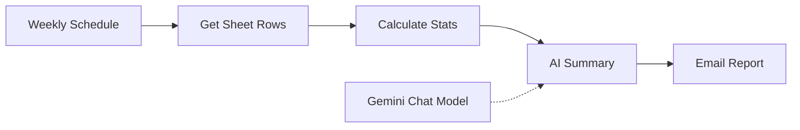

# Weekly Process Report Automation

An [n8n](https://n8n.io) workflow that turns raw process readings in a Google Sheet into a plain-English weekly management report, and emails it automatically.

It reads a week of data, calculates the statistics and flags out-of-limit readings with code, then uses an AI model to write the summary. Nothing is calculated by the AI, so the numbers in the report are always exact.

> Built with a chemical engineering use case in mind: reactor temperature, pressure and yield. It works for any numeric data you track, such as sales, expenses or sensor readings.

## What it does

Every Monday at 07:00 the workflow:

1. Reads all rows from a Google Sheet.
2. Splits them into **this week** and **last week**.
3. Calculates the total, average, minimum, maximum and week-over-week % change for each metric.
4. Flags any reading outside your set limits (for example, temperature above 85 °C).
5. Sends the figures to an AI model, which writes a 5-sentence management summary with one recommended action.
6. Emails the summary, with the subject line showing the period and the number of alerts.

Example subject line: `Weekly Process Report: 2026-11-03 to 2026-11-10 (9 alerts)`

## Workflow



| Node | Purpose |
|------|---------|
| **Weekly Schedule** | Triggers the workflow every Monday at 07:00 |
| **Get Sheet Rows** | Reads all rows from Google Sheets |
| **Calculate Stats** | JavaScript that filters by date, computes statistics and builds the alert list |
| **AI Summary** | Basic LLM Chain that turns the figures into a written summary |
| **Gemini Chat Model** | The language model used by the chain |
| **Email Report** | Sends the summary through Gmail |

### Why code first, AI second

Language models can make arithmetic mistakes. Here the Code node does every calculation and limit check, and the AI only describes numbers that are already correct.

## Repository contents

| File | Description |
|------|-------------|
| `weekly_process_report_clean.json` | The n8n workflow, ready to import (credentials removed) |
| `n8n_weekly_report_code_node.js` | The Code node logic as a standalone, commented file |
| `process_data_dummy.csv` | Sample data to test with |

## Setup

### Requirements

- An n8n instance (cloud or self-hosted)
- A Google account (Sheets and Gmail)
- A Google Gemini API key (or swap in another chat model)

### Steps

1. **Create the sheet.** Import `process_data_dummy.csv` into a new Google Sheet (File → Import → Upload). If everything lands in column A, select it and use Data → Split text to columns. Headers must be `Date, Temperature, Pressure, Yield`.
2. **Import the workflow.** In n8n, open the menu (⋯) → Import from file → choose `weekly_process_report_clean.json`.
3. **Reconnect credentials** in the Google Sheets, Gemini and Gmail nodes.
4. **Configure the nodes.**
   - *Get Sheet Rows*: select your spreadsheet and sheet.
   - *Email Report*: replace `you@example.com` with your address.
5. **Test.** Click **Execute workflow**. Every node should show a green tick and an email should arrive.
6. **Activate** the workflow so the schedule runs on its own.

> **Note on sample data:** the dummy dates run from 2026-10-20 to 2026-11-10 and only fall inside the 7-day window around those dates. If you test later, shift the dates forward or increase `DAYS` in the Code node.

## Customisation

All settings are at the top of the Code node:

```js
const DAYS = 7;                                         // reporting window
const METRICS = ['Temperature', 'Pressure', 'Yield'];   // must match your sheet headers exactly
const LIMITS = {
  Temperature: { max: 85 },
  Pressure:    { max: 5 },
  Yield:       { min: 90 },
};
```

- **Different metrics:** change `METRICS` and `LIMITS` to match your column headers.
- **Different schedule:** edit the Weekly Schedule node.
- **Different AI model:** replace the Gemini node with any chat model supported by n8n.
- **Different report style:** edit the prompt in the AI Summary node.

## Sample output

With the included dummy data, the report highlights temperatures exceeding 85 °C, pressure above 5, and yield falling below 90% in the latest week, then recommends one corrective action.

<!-- Add a screenshot of the workflow and a sample email here:


-->

## Ideas for improvement

- Send an immediate alert when a limit is breached, not just weekly.
- Email different summaries to operators and management.
- Feed the sheet directly from sensors or a form.
- Attach a chart of the weekly trends.

## Tech stack

n8n · Google Sheets · Google Gemini · Gmail · JavaScript

## License

MIT
