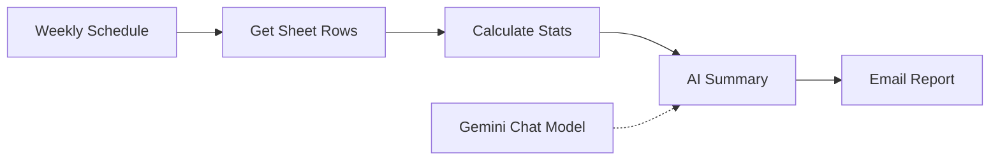

[README (1).md](https://github.com/user-attachments/files/34964500/README.1.md)
# Weekly Process Report Automation

An [n8n](https://n8n.io) workflow that turns raw process readings in a Google Sheet into a plain-English weekly management report, and emails it automatically.

Code does all the calculations and limit checks. An AI model only writes the summary. Language models can slip on arithmetic, so this keeps the numbers in the report exact.

> Built with a chemical engineering use case in mind (reactor temperature, pressure and yield), but it works for any numeric data you track, such as sales, expenses or sensor readings.

## Sample output

This is the email the workflow produced from the included sample data:


The report picked out the rising temperature and pressure, the nine limit breaches, the drop in yield below 90%, and gave one recommended action. All of those figures came from the Code node, not the AI.

## What it does

Every Monday at 07:00 the workflow:

1. Reads all rows from a Google Sheet.
2. Splits them into **this week** and **last week**.
3. Calculates the total, average, minimum, maximum and week-over-week % change for each metric.
4. Flags any reading outside your set limits (for example, temperature above 85 °C).
5. Sends the figures to an AI model, which writes a 5-sentence management summary with one recommended action.
6. Emails the summary.

## Workflow



### 1. Schedule Trigger
Fires weekly on Monday at 07:00. For testing, run the workflow manually from the canvas.


### 2. Get row(s) in sheet
Reads every row from the Google Sheet. The built-in filter only matches exact values, so the date filtering happens in the next step instead.


### 3. Code (JavaScript)
Filters the rows by date, calculates the statistics and week-over-week change, and builds the list of alerts. It outputs one compact JSON object. The full commented code is in [`n8n_weekly_report_code_node.js`](n8n_weekly_report_code_node.js).


### 4. Basic LLM Chain
Receives that JSON and writes the management summary using Google Gemini.


### 5. Gmail
Sends the AI's summary by email.


## Repository contents

| File | Description |
|------|-------------|
| `weekly_process_report_clean.json` | The n8n workflow, ready to import (credentials removed) |
| `n8n_weekly_report_code_node.js` | The Code node logic as a standalone, commented file |
| `process_data_dummy.csv` | Sample data to test with |
| `images/` | Screenshots used in this README |

## Setup

### Requirements

- An n8n instance (cloud or self-hosted)
- A Google account (Sheets and Gmail)
- A Google Gemini API key (or swap in another chat model)

### Steps

1. **Create the sheet.** Import `process_data_dummy.csv` into a new Google Sheet (File → Import → Upload). If everything lands in column A, select it and use Data → Split text to columns. Headers must be `Date, Temperature, Pressure, Yield`.
2. **Import the workflow.** In n8n, open the menu (⋯) → Import from file → choose `weekly_process_report_clean.json`.
3. **Reconnect credentials** in the Google Sheets, Gemini and Gmail nodes.
4. **Configure the nodes.** In *Get Sheet Rows*, select your spreadsheet and sheet. In *Email Report*, replace `you@example.com` with your address.
5. **Test.** Click **Execute workflow**. Every node should show a green tick and an email should arrive.
6. **Activate** the workflow so the schedule runs on its own.

## Customisation

All settings are at the top of the Code node:

```js
const DAYS = 7;                                         // reporting window
const METRICS = ['Temperature', 'Pressure', 'Yield'];   // must match your sheet headers exactly
const LIMITS = {
  Temperature: { max: 85 },
  Pressure:    { max: 5 },
  Yield:       { min: 90 },
};
```

- **Different metrics:** change `METRICS` and `LIMITS` to match your column headers.
- **Different schedule:** edit the Schedule Trigger node.
- **Different AI model:** replace the Gemini node with any chat model supported by n8n.
- **Different report style:** edit the prompt in the AI Summary node.

## Known limitations and lessons learned

**The sample data goes stale.** The report window is always the last 7 days from today, and the sample dates run from 2026-10-20 to 2026-11-10. When I ran the workflow a week later, no rows fell inside the window. The Code node reported `rowsInPeriod: 0` and the week-over-week change came back as `null`. The AI then wrote a report about a "monitoring outage" instead of crashing, which is reasonable behaviour, but it shows the workflow doesn't yet distinguish "no data was logged" from "the sheet needs updating".

If you test with the sample data later, shift the dates forward or increase `DAYS` in the Code node.

**Ideas to fix and extend it:**

- Add a check that stops the workflow, or sends a clear "no data" email, when `rowsInPeriod` is 0.
- Make the email subject dynamic, showing the period and number of alerts.
- Send an immediate alert when a limit is breached, not just weekly.
- Email different summaries to operators and management.
- Feed the sheet directly from sensors or a form.
- Attach a chart of the weekly trends.

## Tech stack

n8n · Google Sheets · Google Gemini · Gmail · JavaScript

## License

MIT
